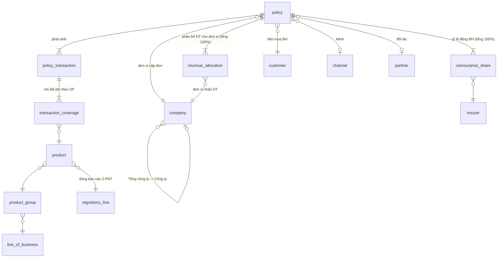

# Căn cứ thiết kế: mô hình dữ liệu POC Doanh thu bảo hiểm v2

Tài liệu này trả lời câu hỏi "**tại sao** mô hình được thiết kế như vậy" cho từng bảng, từng quy tắc và từng con số trong dữ liệu dummy.

Mọi căn cứ đều là nguồn **public**:
- luật, nghị định, thông tư (đọc trực tiếp trên vbpl.vn);
- số liệu thị trường của IAV và Bộ Tài chính;
- thông tin sản phẩm công khai của các DNBH;
- các chuẩn mô hình dữ liệu ngành bảo hiểm quốc tế.

Chi tiết nguồn nằm trong [sources/](sources/).

## 1. Nguyên tắc

1. **Khung nghiệp vụ lấy từ quy định.** Danh mục nghiệp vụ, kênh phân phối, cách ghi nhận doanh thu, đồng bảo hiểm, hoàn/giảm phí, biểu phí bắt buộc, thuế GTGT và trần hoa hồng đều lấy từ văn bản pháp luật hiện hành.
2. **Con số lấy từ số liệu công bố.** Quy mô và cơ cấu nghiệp vụ theo BCTC kiểm toán công khai của Bảo hiểm PVI; mùa vụ, kênh, mức phí, tỷ giá theo công bố của PVI, IAV, Bộ Tài chính, KBNN. Không dùng số liệu nội bộ của bất kỳ doanh nghiệp nào.
3. **Tổ chức lấy theo thông tin công khai; đối tác phần lớn ẩn danh.** Doanh nghiệp là **Tổng Công ty Bảo hiểm PVI** với các đơn vị thật trên trang mạng lưới pvi.com.vn (không còn doanh nghiệp giả lập "DEMO"). Trọng số khai thác của từng đơn vị là **ước tính**, vì PVI không công bố doanh thu từng đơn vị. Đối tác cũ và DN đồng bảo hiểm vẫn ghi dạng "A, B, C"; riêng 3 đối tác số có công bố hợp tác với PVI (Green SM, ATADI, Fuse) mang tên thật. Mọi giao dịch, khách hàng vẫn là giả lập.
4. **Ánh xạ được về hệ thống thật.** Mỗi khái niệm trong mô hình đều có chỗ tương ứng trong một hệ thống lõi bảo hiểm thực tế. Bản ánh xạ cho giai đoạn ETL nằm ở `docs/Mapping_v2_PIAS.html` (tài liệu nội bộ dự án).

## 2. Kiến trúc



| Lớp | Bảng | Vai trò |
|---|---|---|
| `ref` | 16 bảng danh mục | Chuẩn hóa theo luật và thị trường |
| `core` | `policy`, `policy_transaction`, `transaction_coverage`, `coinsurance_share`, `revenue_allocation` | Giao dịch nghiệp vụ, kiểu "hệ thống lõi bảo hiểm" |

## 3. Căn cứ của từng bảng

### Lớp core

| Bảng | Tại sao có bảng này | Căn cứ public |
|---|---|---|
| `core.policy` | Hợp đồng là đơn vị giao kết pháp lý. Một hợp đồng có thể có nhiều giao dịch phí theo thời gian | Luật KDBH 2022 (khái niệm hợp đồng bảo hiểm); mô hình Policy trong ACORD / IBM IIW |
| `core.policy_transaction` | Doanh thu phát sinh theo **giao dịch**: cấp mới, tái tục, SĐBS, hoàn phí, hủy. Mỗi loại hạch toán vào tài khoản khác nhau | NĐ 46/2023 Điều 49 (khoản phải thu / khoản giảm thu); TT 232/2012 (TK 5111 / 5311 / 5321); Kimball "policy transaction fact" |
| `core.transaction_coverage` | Một hợp đồng có thể gồm nhiều sản phẩm, ví dụ vật chất xe kèm TNDS bắt buộc. Doanh thu phải tách theo **nghiệp vụ** | TT 232/2012 Điều 12: TK 511 chi tiết theo từng nghiệp vụ; TT 67/2023 Mẫu 2-PNT báo cáo theo nghiệp vụ |
| `core.coinsurance_share` | Đồng bảo hiểm là nhiều DNBH cùng nhận 1 hợp đồng theo tỷ lệ. Mỗi DN **chỉ ghi nhận phần phí của mình** | Luật KDBH 2022 Điều 4 khoản 29; TT 232/2012 Điều 19; TT 67/2023 Điều 41 khoản 2 |
| `core.revenue_allocation` | DN nhiều đơn vị cần gán doanh thu cho đơn vị thực sự khai thác: hợp tác giữa các đơn vị, trụ sở khai thác rủi ro lớn, kênh số chuyển doanh thu về địa bàn | Mô hình tổ chức "Tổng công ty → công ty thành viên" của các DNBH lớn (báo cáo thường niên Bảo Việt, PVI: 47–79 công ty thành viên). Đây là **thông lệ quản trị**, không phải quy định pháp lý |

### Lớp ref

| Bảng | Căn cứ public |
|---|---|
| `ref.line_of_business` | Luật KDBH 2022 Điều 7 khoản 1 (3 loại hình: nhân thọ, sức khỏe, phi nhân thọ); NĐ 46/2023 Điều 4 (11 nghiệp vụ phi nhân thọ) và Điều 5 (nghiệp vụ sức khỏe) |
| `ref.regulatory_line` | TT 67/2023 Phụ lục VI, Mẫu 1-PNT/2-PNT. Ví dụ: A.1 Sức khỏe, thân thể; A.2 Chi phí y tế; B.4a TNDS bắt buộc (mô tô / ô tô); B.4b Vật chất xe; B.5a Cháy nổ bắt buộc; B.5b Cháy nổ khác |
| `ref.product_group` | Đúng 8 nhóm sản phẩm trong đề bài, gắn với nghiệp vụ theo luật |
| `ref.product` | Tên sản phẩm theo cách gọi phổ biến trên website các DNBH. Có 3 cột căn cứ: `is_compulsory` (NĐ 67/2023), `vat_rate` (Luật GTGT 48/2024 Điều 5 khoản 8), `max_commission_pct` (TT 67/2023 Điều 51). Thêm 4 sản phẩm bảo hiểm vi mô của PVI có công bố công khai (`MV_*`: Green SM Care, Food Care, DelayCare, thiết bị điện tử trên sàn TMĐT), xếp vào nhóm sẵn có; xem [calibration/README.md](calibration/README.md) |
| `ref.company` | Tổng Công ty Bảo hiểm PVI (công ty con 100% của CTCP PVI — BCTN 2024, trang PDF 12); Trụ sở chính – các Ban kinh doanh, Bảo hiểm PVI Digital ([online.pvi.com.vn/lien-he](https://online.pvi.com.vn/lien-he)) và 46 đơn vị theo [trang mạng lưới](https://www.pvi.com.vn/vi/network); tỉnh = địa chỉ trụ sở. Hanoi Re (nhận tái bảo hiểm) và PVIAM (quản lý quỹ) không cấp hợp đồng gốc nên không có trong bảng |
| `ref.channel` | Luật KDBH 2022 Điều 87 khoản 4 (trực tiếp / qua đại lý, môi giới / đấu thầu / giao dịch điện tử). Bancassurance: Điều 125 khoản 2, NĐ 46 Điều 62, TT 67 Điều 53. Cột `report_channel_group` lấy 3 nhóm kênh của **Mẫu 3-PNT** |
| `ref.partner` | Loại đối tác theo thực tế thị trường: ngân hàng, công ty tài chính, đăng kiểm, đại lý ô tô, OTA, ví điện tử, sàn TMĐT, hãng bay, nhà mạng. PVI Annual Report 2024 nêu kênh API với hãng bay, nhà mạng, sàn TMĐT. Tên đối tác cũ được ẩn danh. 3 đối tác số mới mang tên thật vì có công bố hợp tác với PVI: Green SM ([greensm.com](https://www.greensm.com/vn-vi/bao-hiem-khach-hang)), ATADI ([pvi.com.vn](https://www.pvi.com.vn/vi/news/bao-hiem-pvi-ra-mat-delaycare-giai-phap-bao-hiem-tre-chuyen-bay-danh-cho-hanh-khach)), Fuse ([help.shopee.vn](https://help.shopee.vn/portal/4/article/79225)) |
| `ref.province`, `ref.region` | NQ 202/2025/QH15: 34 tỉnh/thành từ 01/7/2025. Chia Bắc/Trung/Nam là **đề xuất của dự án**, vì không có văn bản pháp lý nào chia 3 miền |
| `ref.fx_rate` | Tỷ giá hạch toán hằng tháng của Kho bạc Nhà nước năm 2025. Năm 2024 là ước tính |
| `ref.transaction_type` | NĐ 46/2023 Điều 49 khoản 3 (hoàn phí, giảm phí là khoản giảm thu); TT 232/2012 (TK 5111, 5311, 5321) |

## 4. Quy tắc doanh thu

```
doanh thu = transaction_coverage.premium_vnd  (phí 100% hợp đồng, VND, chưa VAT)
          × coinsurance_share.share_pct('OWN')  (phần của công ty trong đồng BH)
          × revenue_allocation.allocation_pct   (phần phân bổ cho đơn vị)
```

| Quy tắc | Căn cứ |
|---|---|
| Chỉ tính phần phí của công ty khi đồng BH | TT 232/2012 Điều 19; TT 67/2023 Điều 41 khoản 2 |
| Ghi nhận khi **phát sinh trách nhiệm bảo hiểm**. Mô hình hóa: `accounting_date` = max(ngày cấp, ngày bắt đầu hiệu lực). Vì vậy hợp đồng cấp tháng 12/2025 có hiệu lực tháng 01/2026 sẽ ghi nhận doanh thu năm 2026 | TT 67/2023 Điều 41 khoản 1 (đã sửa bởi TT 96/2026); TK 005 "hợp đồng chưa phát sinh trách nhiệm" trong TT 232/2012 |
| Hoàn phí, giảm phí, hủy đơn mang số âm, cộng vào kỳ phát sinh | NĐ 46/2023 Điều 49 khoản 3; TT 232/2012 (TK 531, 532) |
| Doanh thu tính chưa VAT | Luật GTGT 48/2024 |
| Chỉ tính chứng từ `APPROVED` | Quy ước chuẩn: chỉ chứng từ đã duyệt là căn cứ ghi nhận; `PENDING` / `VOID` là kịch bản kiểm thử |

## 5. Hiệu chỉnh dữ liệu dummy

Chi tiết từng bước nằm ở [GENERATION_LOGIC.md](GENERATION_LOGIC.md). Bảng dưới là tóm tắt.

| Tham số | Giá trị | Nguồn |
|---|---|---|
| Quy mô và cơ cấu doanh thu | 2025: 10.378 tỷ trong phạm vi POC. Sức khỏe & tai nạn 3.213, xe 1.823, cháy nổ 3.451, tài sản ≈ 1.891 | BCTC kiểm toán 2025 của Bảo hiểm PVI, thuyết minh 21 (phí gốc theo nghiệp vụ) |
| Phần tài sản thuần trong "Tài sản & thiệt hại" | 50% | **Ước tính** (BCTC gộp kỹ thuật, năng lượng) |
| Trong Con người | Sức khỏe 75% / Sinh mạng–tai nạn 15% / Du lịch 5% / Học sinh 5% | **Ước tính** ([FPTS, trang 14](https://file.fpts.com.vn/FileStore2/File/2025/04/14/DuyenNTM14042025Bao_cao_dinh_gia_lan_dau_PVI_0bef673f.pdf): sức khỏe PVI chủ yếu là nhóm doanh nghiệp) |
| Trong Xe | TNDS bắt buộc 24% / Vật chất xe 76% | IAV 2024 (4.537 / 18.693 tỷ) |
| Mùa vụ | Theo quý: 29,7 / 24,1 / 24,8 / 21,4%; học sinh đỉnh tháng 8–10 | Phí gốc theo quý PVI 2025; báo chí |
| Kênh điện tử | ≈ 6% (2024) → ≈ 10% (2025) | [BCTN PVI 2024, trang 29](https://static2.vietstock.vn/vietstock/2025/3/19/3_pvi_2025_3_19_fb26c59_en_annualreport_2024.pdf) (≈ 800 tỷ); 2025 suy ra từ mức tăng 1,8 lần quý I/2025 ([pvn.vn](https://pvn.vn/khoi-dau-vung-chac-bao-hiem-pvi-huong-toi-moc-doanh-thu-ty-do-la-my-nam-2025-28459)) |
| Môi giới / bancassurance | ≈ 15–20% / ≈ 5–8% | **Ước tính** (thị trường: môi giới 13,5%) |
| Phí TNDS bắt buộc | 437.000 / 794.000 / 756.000 / 853.000 … (ô tô); 55.000 / 60.000 (mô tô) | NĐ 67/2023 Phụ lục I |
| Tỷ lệ phí cháy nổ bắt buộc | 0,05–0,5% theo nhóm cơ sở | NĐ 67/2023 Phụ lục II (bản 2023) |
| Vật chất xe ô tô | 1,1–2,0% giá trị xe | Trong khoảng công bố 0,5–3,5% của DNBH |
| Học sinh | 100–150 nghìn đ/em (tai nạn) | Báo chí: mức phổ biến 100.000 đ |
| Sức khỏe cá nhân | từ 1,45 triệu đ | Phí niêm yết trên website các DNBH |
| Du lịch | từ 17 nghìn đ (trong nước); 4–45 USD (quốc tế) | Phí niêm yết trên website các DNBH |
| Hoa hồng | ≤ trần theo nghiệp vụ; bằng 0 với bán trực tiếp và đấu thầu | TT 67/2023 Điều 51 |
| Đơn vị | Trụ sở chính, PVI Digital và 46 đơn vị thật; trọng số khai thác theo quy mô kinh tế địa bàn, ×1,5 cho Phía Nam, Thủ Đô, Duyên Hải, Thăng Long, Sài Gòn | Danh sách: [pvi.com.vn/vi/network](https://www.pvi.com.vn/vi/network). Trọng số: **Ước tính** (PVI không công bố doanh thu từng đơn vị; ×1,5 theo các bài vinh danh của PVI và [pvisg.net](https://pvisg.net)) |
| Bảo hiểm vi mô (bộ khối lượng lớn) | Green SM Care 1.000 / 2.000 đ/chuyến; Food Care 1.000 đ/đơn; DelayCare 35.000 đ/người; thiết bị điện tử 1,5–3,5% giá máy. ≈ 51.700 GCN/ngày | Phí Green SM: [greensm.com](https://www.greensm.com/vn-vi/bao-hiem-khach-hang), [greensm.com](https://www.greensm.com/vn-vi/bao-hiem-giao-do-an). Phí DelayCare, thiết bị điện tử và số GCN/ngày: **Ước tính** (căn cứ ở [calibration/README.md](calibration/README.md)) |
| Quy mô bộ khối lượng lớn (tháng 8–9/2026) | Đúng quy mô PVI: phí gốc khai thác 1.600,6 tỷ trên DB, ngân sách ≈ 1.602 tỷ; không còn hệ số nhân k | Mục tiêu năm ở dòng đầu × tỷ trọng tháng 8, 9 của Bộ Tài chính (13.594 / 88.054) |

## 6. Hỏi đáp "Tại sao…"

**Tại sao mô hình này nhìn giống hệ thống của chúng tôi?**

Mọi DNBH phi nhân thọ tại Việt Nam đều phải đáp ứng cùng một bộ quy định:
- hợp đồng và SĐBS;
- đồng bảo hiểm chỉ ghi nhận phần của mình (TT 232 Điều 19);
- hoàn/giảm phí là khoản giảm thu (NĐ 46 Điều 49);
- báo cáo theo nghiệp vụ và theo kênh (TT 67 Mẫu 2-PNT, 3-PNT);
- biểu phí bắt buộc (NĐ 67);
- mô hình Tổng công ty → công ty thành viên.

Các chuẩn mô hình dữ liệu ngành (IBM IIW, ACORD, Kimball) cũng dùng đúng cấu trúc hợp đồng → giao dịch → coverage. Vì vậy hệ thống của các DNBH thường giống nhau về bản chất.

Dữ liệu dummy **không** chứa số liệu, khách hàng hay mã nội bộ của Quý công ty. Tên doanh nghiệp, đơn vị và 3 đối tác số chỉ lấy từ thông tin công khai; doanh thu theo đơn vị, theo đối tác là số giả lập.

**Mô hình có theo chuẩn quốc tế không?**

Có. Cấu trúc hợp đồng → giao dịch → coverage → phần tham gia của DNBH trùng với nhiều chuẩn:
- Microsoft Common Data Model P&C (Policy, **PolicyTransaction**, Coverage, Insurer, Agency);
- OMG P&C Data Model (Policy, **Policy Coverage Detail**, Policy Amount);
- IBM IIW (Agreement, Financial Transaction, Party role);
- ACORD P&C (Coverage `NetChangeAmt`).

Hai cột đối chiếu quốc tế được thêm vào danh mục:
- loại giao dịch mang mã ACORD (NBS / RWL / PCH / XLC);
- sản phẩm mang mã Solvency II LoB.

Chi tiết xem [sources/international_standards.md](sources/international_standards.md).

**Tại sao doanh thu nhỏ hơn tổng phí ghi trên hợp đồng?**

Với đơn đồng bảo hiểm, công ty chỉ ghi nhận phần tỷ lệ của mình (TT 232 Điều 19). Tỷ lệ này nằm ở `core.coinsurance_share`, dòng `insurer_code = 'OWN'`.

**Tại sao doanh thu của Công ty X khác tổng phí các đơn X cấp?**

Doanh thu được gán theo **đơn vị được phân bổ** chứ không theo đơn vị cấp đơn. Có 3 trường hợp:
- hợp tác khai thác giữa các đơn vị;
- Trụ sở chính khai thác rủi ro lớn cùng đơn vị thành viên;
- Bảo hiểm PVI Digital chuyển doanh thu về đơn vị quản lý khách hàng.

Tỷ lệ phân bổ nằm ở `core.revenue_allocation`, loại phân bổ ở `allocation_type_code`.

**"Doanh thu Tổng công ty" là gì?**

**Quy ước chuẩn:** doanh thu Tổng công ty = tổng doanh thu hợp nhất của mọi đơn vị. Đây là cấp nằm giữa "Tổng doanh thu" và "Công ty" trong đề bài.

Trụ sở chính – các Ban kinh doanh (`HO`, `company_type = HEAD_OFFICE`) được tính là **một đơn vị ngang cấp Công ty**, tương tự Bảo hiểm PVI Digital (`DGT`, `company_type = DIGITAL`). Doanh thu do trụ sở trực tiếp khai thác vẫn xem riêng được qua đơn vị này.

**Tại sao dùng tên PVI thật mà không dùng doanh nghiệp giả lập?**

Quy mô và cơ cấu doanh thu vốn đã lấy từ BCTC công khai của Bảo hiểm PVI, nên gọi đúng tên giúp người xem đối chiếu được. Tên đơn vị lấy từ [trang mạng lưới](https://www.pvi.com.vn/vi/network); tỉnh của đơn vị là địa chỉ trụ sở. PVI **không** công bố doanh thu từng đơn vị (đã tìm và không thấy), nên trọng số khai thác là **ước tính**: theo quy mô kinh tế địa bàn, ×1,5 cho Phía Nam (xuất sắc nhất 2024), Thủ Đô (6 tháng 2025), Duyên Hải (xuất sắc nhất 2025), Thăng Long (hoàn thành sớm kế hoạch 2025) và Sài Gòn (tự công bố doanh thu đứng đầu hệ thống bán lẻ). Doanh thu theo đơn vị trên dashboard vì vậy **không** phải số của PVI.

**So với cả PVI thì sao? Tại sao không có Hanoi Re, PVIAM?**

Bảo hiểm PVI là công ty con 100% của CTCP PVI (PVI Holdings). Năm 2025: doanh thu hợp nhất Holdings 28.923 tỷ; Bảo hiểm PVI 27.258 tỷ (94,2%), trong đó phí bảo hiểm gốc 14.908 tỷ; Hanoi Re (tên cũ PVI Re, Holdings sở hữu 81,09%) 3.690 tỷ; PVIAM (61,96%) 76,4 tỷ (BCTN 2025, trang PDF 29, 32, 33, 34). Hanoi Re nhận tái bảo hiểm, PVIAM quản lý quỹ; cả hai không cấp hợp đồng bảo hiểm gốc nên nằm ngoài phạm vi doanh thu phí gốc và không có trong `ref.company`. POC chỉ gồm 4 nghiệp vụ của Bảo hiểm PVI (10.378 tỷ năm 2025).

**Tại sao > 50.000 giao dịch/ngày mà doanh thu vẫn đúng quy mô PVI?**

Khối lượng đến từ **bảo hiểm vi mô** theo chuyến / theo đơn (≈ 51.700 GCN/ngày, phí 1.000–2.000 đ với chuyến xe và đồ ăn). Doanh thu vi mô nằm trong ngân sách nhóm và được coi là dòng cố định khi hiệu chỉnh, nên tổng doanh thu và cơ cấu nhóm không đổi. Trên DB, GCN vi mô chiếm 77,3% số hợp đồng nhưng chỉ 1,3% doanh thu. Bản trước (16–18/10/2026) nhân mọi ngân sách với một hệ số quy mô, nên doanh thu ≈ 4 lần PVI; cách đó đã bỏ.

**Tại sao đối tác chuyến xe là Green SM mà không phải Grab?**

Bảo hiểm chuyến đi của Grab (Ride Cover) do **Chubb** cung cấp, của Be do **OPES** ([tinnhanhchungkhoan.vn](https://www.tinnhanhchungkhoan.vn/bao-hiem-so-don-tin-vui-tu-xe-cong-nghe-post352383.html)). Hợp tác Grab × PVI năm 2026 là BHXH/BHYT tự nguyện cho tài xế ([grab.com](https://www.grab.com/vn/blog/driver/bhxh-bhyt-pvi/)), không phải bảo hiểm theo cuốc. Green SM Care thì có PVI Digital là một trong 5 nhà bảo hiểm ([greensm.com](https://www.greensm.com/vn-vi/bao-hiem-khach-hang)).

**Các nguồn về đơn vị và bảo hiểm vi mô được tìm thế nào?**

Nghiên cứu chéo bằng hai công cụ với cùng một đề bài: codex CLI (gpt-6.1-sol) và agy CLI (gemini-3.8-flash-high). Kết quả hai bên được đối chiếu; mọi link được kiểm lại bằng curl ngày 19/10/2026. Thông tin chỉ một bên đưa ra mà không kiểm chứng được thì loại (ví dụ danh sách "7 đơn vị về đích sớm"). Danh sách nguồn đầy đủ: [sources/market_data.md](sources/market_data.md) mục 9, 10 và bảng nguồn trong [calibration/README.md](calibration/README.md).

**Tại sao cháy nổ xếp vào "Tài sản"?**

Đề bài gộp như vậy (nhóm POC). Theo quy định, cháy nổ là nghiệp vụ riêng (NĐ 46 Điều 4; dòng B.5 trong Mẫu 2-PNT). Mô hình giữ **cả hai** cách phân loại: `poc_group` để phân tích, `report_line_code` để đối chiếu báo cáo Bộ Tài chính.

**Tại sao học sinh, du lịch, sinh mạng nằm trong "Con người"?**

Tất cả thuộc loại hình **bảo hiểm sức khỏe** theo Luật KDBH 2022 Điều 4 khoản 15 (thương tật, tai nạn, ốm đau, chăm sóc sức khỏe) và NĐ 46 Điều 5. Đây cũng là nhóm không chịu thuế GTGT (Luật GTGT 48/2024 Điều 5 khoản 8).

**Tại sao phí TNDS là 437.000 hay 60.000?**

Đó là biểu phí bắt buộc, chưa VAT, tại NĐ 67/2023 Phụ lục I.

**Tại sao có doanh thu tháng 01/2026 trong khi dữ liệu chỉ đến 2025?**

Hợp đồng cấp cuối tháng 12/2025 nhưng bắt đầu hiệu lực tháng 01/2026. Doanh thu ghi nhận khi phát sinh trách nhiệm bảo hiểm (TT 67 Điều 41).

**Tại sao doanh thu tháng khác với tổng phí các đơn cấp trong tháng?**

Hai số này dùng hai ngày khác nhau:
- doanh thu tính theo ngày phát sinh trách nhiệm (`core.policy_transaction.accounting_date`);
- phí khai thác tính theo ngày chứng từ (`core.policy_transaction.txn_date`).

**Tại sao có khách hàng "Khách lẻ theo bảng kê"?**

Đơn TNDS, du lịch bán theo lô giấy chứng nhận qua đối tác (đăng kiểm, OTA…) thường ghi bên mua là khách lẻ gộp. Cờ `is_aggregated_retail` giúp loại nhóm này khi phân tích khách hàng định danh.

**Tại sao có 7 kênh nhưng báo cáo chỉ có 3 nhóm?**

- 7 kênh theo hình thức phân phối ở Luật KDBH Điều 87 khoản 4, tách chi tiết đại lý cá nhân / tổ chức / TCTD.
- 3 nhóm là nhóm kênh bắt buộc của Mẫu 3-PNT (TT 67): qua TCTD / qua môi trường mạng / khác.

**Tại sao quý 1 cao nhất, quý 4 thấp nhất?**

Theo phí gốc hợp nhất công bố của PVI năm 2025, các quý chiếm 29,7 / 24,1 / 24,8 / 21,4%. Nguyên nhân là các chương trình bảo hiểm doanh nghiệp (sức khỏe nhóm, tài sản, cháy nổ) tái tục đầu năm. Riêng học sinh tập trung đầu năm học.

**Tại sao cháy nổ chiếm khoảng 1/3 doanh thu, còn xe chỉ khoảng 18%?**

Cơ cấu này lấy theo BCTC kiểm toán 2025 công khai của Bảo hiểm PVI: cháy nổ 3.451 tỷ, sức khỏe & tai nạn 3.213 tỷ, xe 1.823 tỷ. Đó là đặc thù của doanh nghiệp thiên về khách hàng công nghiệp. Bình quân thị trường thì xe chiếm khoảng 24%. Chi tiết xem [GENERATION_LOGIC.md](GENERATION_LOGIC.md).

**Tại sao hoàn phí và giảm phí là số âm và có tài khoản riêng?**

Đây là khoản giảm thu (NĐ 46 Điều 49 khoản 3), hạch toán vào TK 5311 / 5321 (TT 232/2012).

**Tại sao dùng 34 tỉnh cho cả dữ liệu 2024?**

Báo cáo dùng đơn vị hành chính **hiện hành** (NQ 202/2025) để so sánh được giữa các năm.

## 7. Quy ước chuẩn của dự án

Những điểm không có số công bố hoặc nguồn không nói rõ được dự án **tự chốt** theo căn cứ hợp lý nhất. Các quy ước này là chuẩn cho bộ dữ liệu và cho ETL sau này. Quy ước ánh xạ với hệ thống nguồn nằm ở `docs/Mapping_v2_PIAS.html`, mục "Quy ước chuẩn đã chốt".

| Nội dung | Quy ước chuẩn | Căn cứ |
|---|---|---|
| Tỷ lệ phí cháy nổ bắt buộc | Dùng biểu tỷ lệ tối thiểu NĐ 67/2023 Phụ lục II | Văn bản đọc được toàn văn. Phụ lục VI của NĐ 105/2025 thay thế chỉ có bản scan |
| Tỷ giá USD năm 2024 | Nội suy theo tỷ giá trung tâm NHNN | Năm 2025 dùng số công bố của KBNN |
| Chia trong nhóm Con người | Sức khỏe 75 / sinh mạng–tai nạn 15 / du lịch 5 / học sinh 5% | Mảng sức khỏe PVI chủ yếu là nhóm doanh nghiệp (FPTS) |
| Tài sản thuần trong "Tài sản & thiệt hại" | 50% | BCTC PVI gộp tài sản với kỹ thuật, năng lượng |
| Trọng số khai thác của đơn vị | Theo quy mô kinh tế địa bàn; ×1,5 cho 5 đơn vị được vinh danh / tự công bố dẫn đầu | PVI không công bố doanh thu từng đơn vị |
| Số GCN vi mô/ngày (bộ khối lượng lớn) | 40.000 chuyến xe · 8.000 đồ ăn · 300 DelayCare · 3.000 thiết bị điện tử | Quy ước để đạt > 50.000 giao dịch/ngày; kiểm tra độ hợp lý với quy mô Green SM (> 1 triệu chuyến/ngày) và OPES (109,3 triệu hợp đồng năm 2023) |
| Phạm vi | Không gồm thu phí nhiều kỳ, leading fee, nhận / nhượng tái bảo hiểm | Đề bài chỉ yêu cầu doanh thu phí bảo hiểm gốc |
| Solvency II cho tai nạn, sinh mạng, du lịch | Income protection / Medical expense | Theo bản chất rủi ro chính |
| Vùng miền | Bắc 15 / Trung 11 / Nam 8 tỉnh | Không có văn bản pháp lý chia 3 miền sau sáp nhập |
| `accounting_date` | max(ngày cấp, ngày hiệu lực); SĐBS = ngày chứng từ | TT 67/2023 Điều 41: phí đã đóng đủ hoặc có thỏa thuận nợ phí theo Điều 26 |
